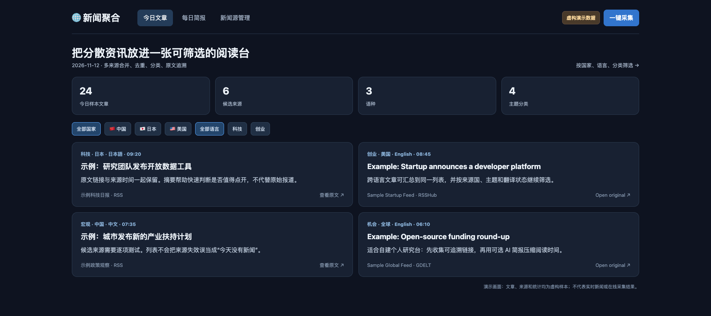
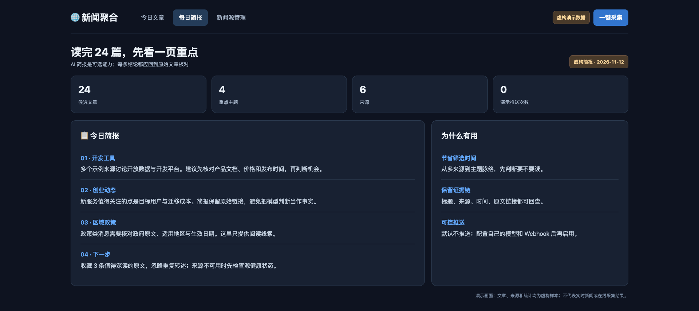
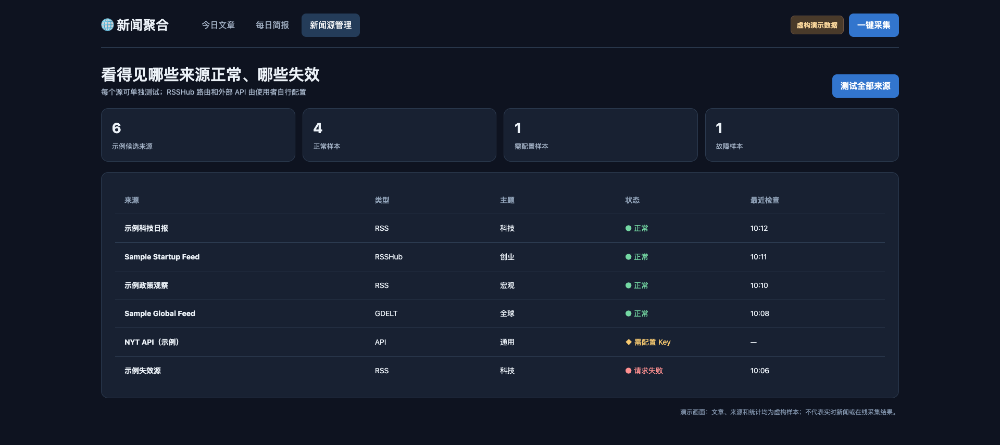

# News Aggregator

**Language:** [简体中文](README.md) · English · [日本語](README.ja.md)

**Follow several countries and topics without reopening twenty sites every morning.** Bring candidate sources into one filterable reading view, keep links to the originals, and see when a source fails. An optional briefing highlights what deserves a closer read; it never replaces the source article.

Need help with installation, a private deployment, or a customization that follows your workflow? Contact us at [buildwithneo.cn](https://buildwithneo.cn).

### Three views · fictional illustrative data

**Reading view:**

**Daily briefing:**

**Source health:**

The [preview page](docs/demo.html) is an illustrative mockup. It does not show live collection or real news.

Collect public RSS, RSSHub, GDELT, and optional NYT API articles into a local web view and optional AI briefing. Feishu webhook delivery is optional. The site binds to localhost by default.

## Quick start

Use Python 3.11+ and Docker. Copy `.env.example` to `.env` and set `POSTGRES_PASSWORD`. Run `docker compose up -d`, install dependencies with `pip install -r requirements.txt`, and start the site with `python api/app.py`. Open `http://127.0.0.1:8099`. Run `python main.py` for scheduled collection. `DRY_RUN=true` disables outbound delivery by default.

Sources are listed in `config/sources.yaml`; test each source in the web UI before relying on it. Some RSSHub routes require your own RSSHub instance. OpenRouter, NYT, and Feishu features require separate credentials. Source availability and licensing can change. If exposing the API beyond localhost, add authentication and a reverse proxy first.

The public release excludes `.env`, logs, and database content. Configuration tests pass; live sources, PostgreSQL/Redis, and delivery require environment-specific verification. MIT License.

## Languages

Use the lower-right selector for Chinese, English, or Japanese navigation, filters, and common status labels. External titles, source text, and diagnostic details remain in their original language.
