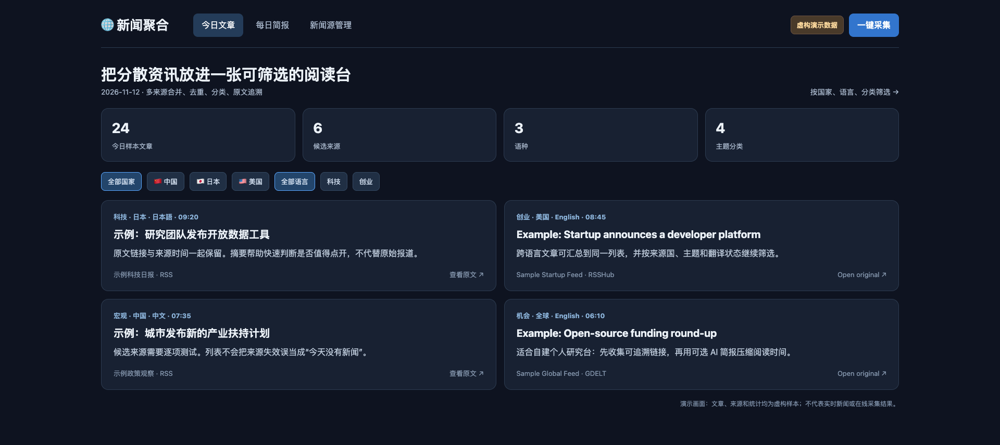
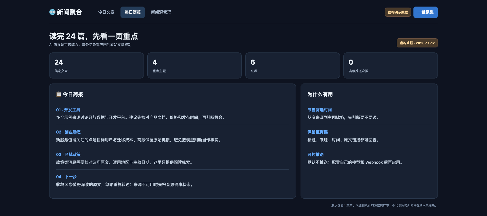
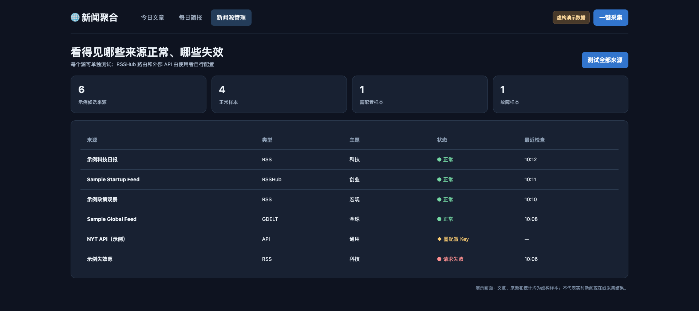

# ニュース集約

**言語:** [简体中文](README.md) · [English](README.en.md) · 日本語

**毎朝、多くのサイトを開き直さずに、複数の国やテーマを追跡できます。** 候補ソースを絞り込める一覧に集め、元記事へのリンクを残し、ソースの失敗も確認できます。任意のダイジェストは詳しく読むべき内容を示しますが、元記事の代わりにはなりません。

インストール支援、プライベート導入、または業務フローに合わせたカスタマイズが必要な場合は、[buildwithneo.cn](https://buildwithneo.cn) までご連絡ください。

### 三つの画面 · 架空の説明用データ

**記事一覧:**

**日次ダイジェスト:**

**ソース状態:**

[プレビュー画面](docs/demo.html)は説明用のモックです。実際の収集結果やニュースではありません。

公開 RSS、RSSHub、GDELT、任意の NYT API から記事を収集し、ローカル画面と任意の AI 要約にまとめます。Feishu Webhook への配信は任意です。初期設定ではローカルホストでのみ公開します。

## クイックスタート

Python 3.11 以上と Docker が必要です。`.env.example` を `.env` にコピーし、`POSTGRES_PASSWORD` を設定します。`docker compose up -d` を実行し、`pip install -r requirements.txt` で依存関係を入れ、`python api/app.py` で起動してください。`http://127.0.0.1:8099` を開きます。定期収集は `python main.py` で開始します。初期値 `DRY_RUN=true` では外部配信を行いません。

ニュースソースは `config/sources.yaml` にあります。利用前に画面で個別にテストしてください。RSSHub の一部ルートには自分のインスタンスが必要です。OpenRouter、NYT、Feishu の機能には別途認証情報が必要です。ソースの稼働状況や利用条件は変わります。ローカルホスト以外に公開する場合は、先に認証とリバースプロキシを追加してください。

公開版には `.env`、ログ、データベースを含めていません。設定テストは通過していますが、実際のソース、PostgreSQL/Redis、配信は各環境で検証が必要です。MIT License。

## 言語

画面右下の選択メニューで中国語・英語・日本語のナビゲーション、フィルター、主な状態表示を切り替えられます。外部のタイトル、原文、診断の詳細は元の言語のまま表示します。
