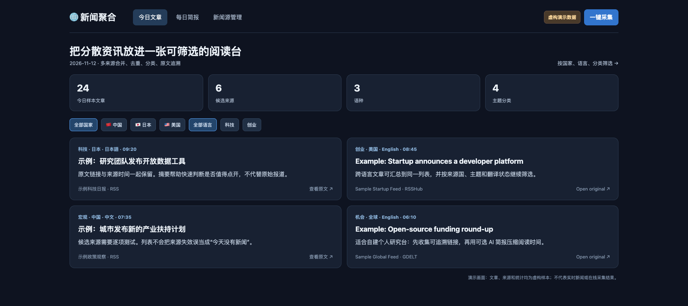
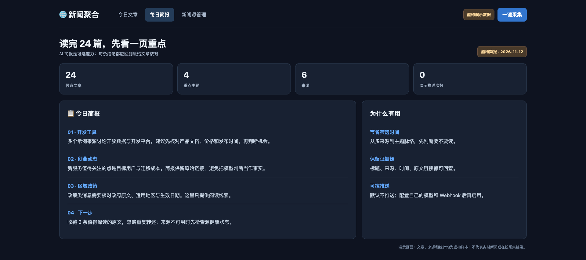
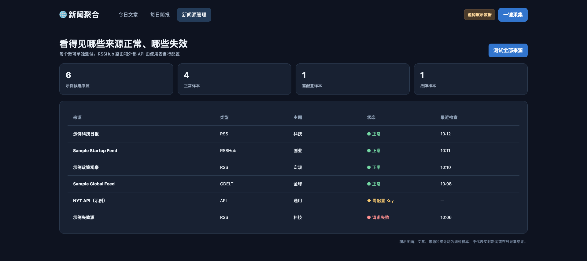

**语言 / Language / 言語:** [简体中文](README.md) · [English](README.en.md) · [日本語](README.ja.md)

# News Aggregator / 新闻聚合

**把分散在多个站点的资讯收进一张可筛选的阅读台，并知道哪些来源真的还在工作。** 适合需要长期跟踪几个国家、行业或主题的个人与小团队：先汇总原文链接和时间，再按来源、语言、国家、主题筛选；需要时生成简报。

| 常见痛点 | 这个项目给出的能力 |
|---|---|
| 每天打开很多站点，容易重复看同一条新闻 | RSS、RSSHub、GDELT 与可选 API 进入同一列表 |
| 看到摘要却找不到原始依据 | 保留来源、发布时间、原文链接和原始语言 |
| 来源悄悄失效，误以为“今天没新闻” | 来源页可单独测试并查看状态 |
| 想要重点，但不想无条件相信 AI | 可选简报压缩阅读量，重要结论仍回到原文核对 |

### 三张演示画面

下列画面用**虚构文章与来源**展示预期使用方式，是可在 [演示页](docs/demo.html) 打开的说明性预览；不是实时新闻或线上采集结果。

**1. 跨来源文章列表**

**2. 每日重点简报**

**3. 来源健康状态**

## 自己运行

需要 Python 3.11+ 和 Docker。复制 `.env.example` 为 `.env`，设置 `POSTGRES_PASSWORD`。用 `docker compose up -d` 启动 PostgreSQL 与 Redis，安装依赖 `pip install -r requirements.txt`，运行 `python api/app.py`，在 `http://127.0.0.1:8099` 打开页面。定时采集入口是 `python main.py`。

`config/sources.yaml` 是候选来源清单，部分 RSSHub 路由需要你自己的实例。首次使用请在“来源”页逐项测试。OpenRouter、NYT API 和飞书 Webhook 都是可选能力；未配置时不会调用这些服务。默认 `DRY_RUN=true`，不向外推送。

## 适用边界

来源可用性和许可会变化，使用者需遵守各站速率限制。网页默认仅绑定 `127.0.0.1`；开放给其他人前需加认证。公开仓库不含 `.env`、日志或数据库。配置测试已通过；真实 PostgreSQL/Redis、在线来源和推送尚需在部署环境验证。

## 语言

网页右下角可切换中文、English、日本語的主导航、筛选与常见状态。文章原文和来源名称保留原始语言。

MIT License。本项目与新闻来源、飞书或模型服务商无隶属关系。
